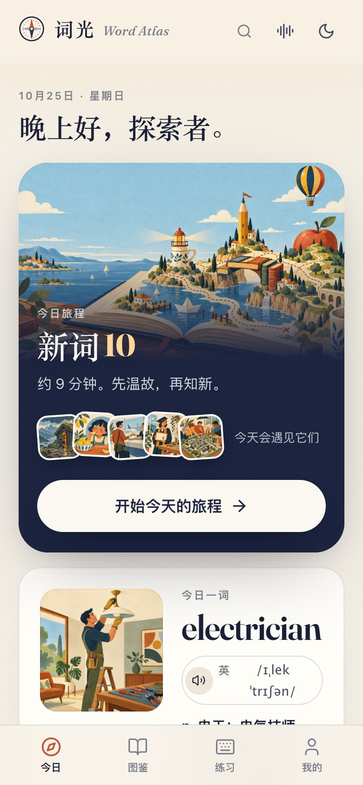
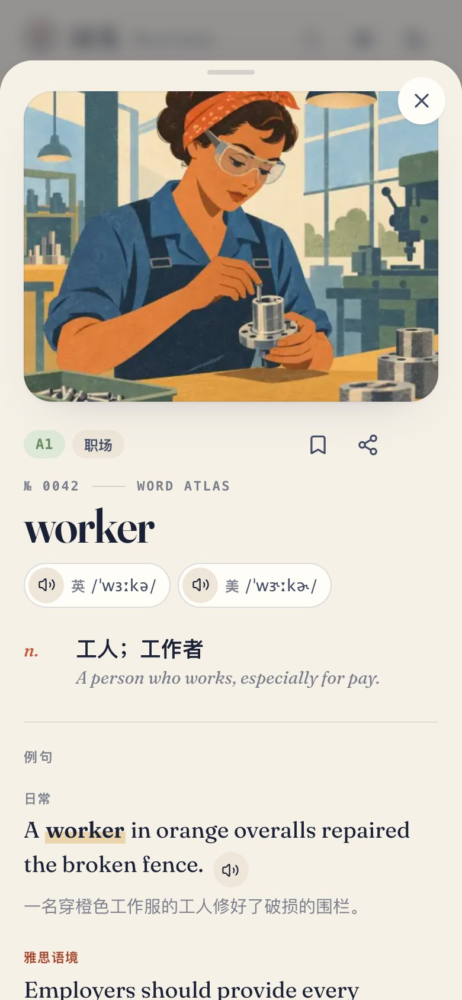
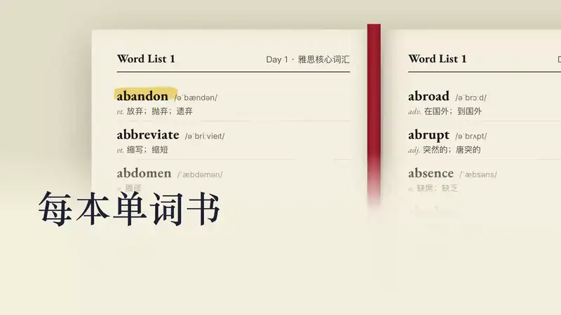

<div align="center">

<a href="https://appxa.github.io/word-atlas/"></a>

# واژه‌نگار · Word Atlas

**واژه‌ها را تصویری کن تا مرورشان قابل پیگیری باشد.**

7298 ورودی آیلتس · تصاویر اصلی · تلفظ انگلیسی و آمریکایی · بررسی فاصله FSRS

[**امتحانش کن ↗**](https://appxa.github.io/word-atlas/) / [معرفی ۴۸ ثانیه‌ای](docs/assets/launch.mp4) / [دانلود واژه‌نامه](data/) / [English](README.en.md)

[](LICENSE)
[](CONTENT_LICENSE.md)

<br>

**نسخه بتا برنامه Ciguang iOS اکنون برای دانلود رایگان باز است: [api.billswise.cn/app](https://api.billswise.cn/app/)**

[](https://x.com/yangleiocx3)

### برای من یک فنجان قهوه بخر

این پروژه متن باز و رایگان است. من خودم پول و زمان زیادی سرمایه گذاری کردم. اگر به نظر شما مفید است، لطفا برای من یک فنجان قهوه بخرید.

<table><tr><td align="center"><br>WeChat</td><td align="center"><br>Alipay</td></tr></table>

</div>

---

Ciguang یک برنامه حفظ لغات آیلتس با تصاویر و زمینه به عنوان هسته آن است. برای درک معنای کلمات به تصاویر نگاه کنید، به تلفظ آن گوش دهید تا ارتباط برقرار کنید، و سپس از یادآوری فعال و بازبینی فاصله ای برای تثبیت حافظه خود استفاده کنید. هیچ حساب کاربری لازم نیست، و پیشرفت یادگیری در دستگاه شما ذخیره می شود.

> **نکته نسخه**: این انبار نسخه اولیه منبع باز Ciguang و مجموعه داده های پشتیبانی را ارائه می دهد. وب سایت آنلاین به طور مستقل تکرار می شود و عملکردها و انبار ممکن است متفاوت باشد. کد و محتوای موجود در انبار مشمول مجوز MIT / CC BY 4.0 زیر است.

[پیش‌نمایش محصول](# پیش‌نمایش محصول) · [روش یادگیری](راه #آموزش) · [اجرای محلی](#اجرای محلی) · [داده‌های باز] (#داده باز) · [شرکت در مشارکت] (# مشارکت در مشارکت)

## پیش نمایش محصول

### یک کتاب واژگان مصور که می توانید گوش دهید و تمرین کنید


<table>
<tr>
<td width="50%"></td>
<td width="50%"></td>
</tr>
<tr><td align="center">برنامه روزانه، تمرکز بر امروز</td><td align="center">تصاویر، معانی کلمات، و تلفظ، در کارت یک کلمه</td></tr>
</table>

<sub>موارد فوق رابط واقعی نسخه منبع باز انبار است. بالای صفحه یک تصویر مفهومی برند است.</sub>

### کلماتی را که آموخته‌اید در نقشه ستاره خود ادغام کنید


19 موضوع نقشه ستاره واژگان را تشکیل می دهند. برای چرخاندن بکشید، برای بزرگنمایی اسکرول کنید و روی ستاره کلیک کنید تا کارت کلمه باز شود. وضعیت یادگیری با روشنایی متفاوت ارائه می شود. با استفاده از WebGL2 ارائه شده است و نمایشگر کاهش یافته را برای دستگاه های پشتیبانی نشده ارائه می دهد.

<details>
<summary><b>ویدیوی تبلیغاتی 48 ثانیه ای را تماشا کنید</b></summary>

<a href="docs/assets/launch.mp4"></a>

[پخش ویدیوی کامل (با صدا)] (docs/assets/launch.mp4)

</details>

## روش های یادگیری

| جلسه | چه خواهید کرد |
| :--- | :--- |
| **ببینید** | هر کلمه با یک تصویر، تعاریف چینی و انگلیسی، دو مثال اصلی، و همچنین ترکیب، خانواده کلمات و نکات استفاده همراه است. |
| ** بشنو ** | بین لهجه‌های انگلیسی و آمریکایی جابه‌جا شوید و به جملات مثال روزانه با صدای بلند گوش دهید. برخی از ورودی ها همچنین شامل ضبط جمله مثال دوم هستند. |
| **یادتون باشه** | کلمات را با نگاه کردن به معانی آنها انتخاب کنید، جملات را با نگاه کردن به تصاویر کامل کنید، کلمات را با گوش دادن به صداها، املای آنها شناسایی کنید و به تدریج یادآوری فعال را تمرین کنید. |
| **بررسی** | FSRS بررسی را بر اساس سوابق یادگیری ترتیب می دهد و میزان حافظه هدف قابل تنظیم است. فقط اولین پاسخ در نرخ صحیح به حساب می آید. |
| **انباشت ** | نمودار ستاره پیشرفت یادگیری را نشان می دهد. آمار مستقل تمرین تایپ؛ از صادرات و بازیابی پیشرفت محلی پشتیبانی می کند. |

**اولویت محلی ** بدون نیاز به ثبت نام؛ ورودی ها و رسانه های مشاهده شده را می توان برای استفاده آفلاین ذخیره کرد. قبل از تغییر دستگاه، لطفاً نسخه پشتیبان پیشرفت را صادر کنید.

<details>
<summary><b>به تلفظ، مثال های جمله و نمونه های صدای محیط گوش دهید</b></summary>


*رها کردن* را به عنوان مثال در نظر بگیرید، برای گوش دادن روی آن کلیک کنید (پخش آنلاین):

| | |
|---|---|
| 🇬🇧 تلفظ انگلیسی | [ترک کردن /əˈbændən/](https://appxa.github.io/word-atlas/atlas/audio/uk/abandon.mp3) |
| 🇺🇸 تلفظ آمریکایی | [ترک کردن /əˈbændən/](https://appxa.github.io/word-atlas/atlas/audio/us/abandon.mp3) |
| 📖 جمله خوانی مثال | [ما مجبور شدیم ماشین خود را در برف رها کنیم.](https://appxa.github.io/word-atlas/atlas/audio/ex/abandon.mp3) |

همه 7298 کلمه دارای تلفظ انگلیسی، تلفظ آمریکایی و جملات مثال با صدای بلند خوانده می شوند و جمله دوم 1011 کلمه کلیدی نیز با صدای بلند خوانده می شود.

### صداهای محیطی و صداهای تعاملی

| | |
|---|---|
| 🎙 **دوبله صفحه باز** | ["به باز کردن درب آیلتس خوش آمدید"](https://appxa.github.io/word-atlas/sfx/splash-voice.mp3): غبار ستاره‌ها «واژه‌نگار» را می‌سازد و دروازه باز می‌شود |
| 🌌 **دوبله نقشه ستاره** | ["این نقشه ستاره واژگان شماست. هر بار که کلمه ای یاد می گیرید، ستاره ای را روشن کنید."](https://appxa.github.io/word-atlas/sfx/voice-galaxy-hello.mp3) |
| 🎵 **Starry Sky Music** | [یک موسیقی متن اصلی که می تواند یکپارچه حلقه شود](https://appxa.github.io/word-atlas/sfx/amb-stars.mp3)، پیش‌فرض هنگام حفظ واژه پخش می‌شود |
| 🌧 **6 صدای محیط** | [کتابخانه روز بارانی](https://appxa.github.io/word-atlas/sfx/amb-rain.mp3)·[ساحل صبح](https://appxa.github.io/word-atlas/sfx/amb-sea.mp3)·[صبح در جنگل](https://appxa.github.io/word-atlas/sfx/amb-forest.mp3)·[شومینه شبانه](https://appxa.github.io/word-atlas/sfx/amb-fire.mp3)·[کلبه سفر](https://appxa.github.io/word-atlas/sfx/amb-voyage.mp3)· [کافه آرام](https://appxa.github.io/word-atlas/sfx/amb-cafe.mp3) |
| ✨ ** جلوه های صوتی رابط ** | پاسخ‌های صحیح، پاسخ‌های اشتباه، برگرداندن کارت‌ها، تایپ کردن، رگه‌های برنده، روشن کردن ستاره‌ها... هر عملیات صدای خاص خود را دارد. هنگام خواندن کلمات | صدای پس زمینه به طور خودکار کاهش می یابد

همه مواد در انبار هستند: تصاویر موجود است`public/atlas/img/`، ثبت شده در`public/atlas/audio/`، این دو دسته تحت CC BY 4.0 باز هستند. صداهای رابط و موسیقی متن زیر هستند`public/sfx/`، همراه با برنامه ارائه شده است.


</details>

## به صورت محلی اجرا کنید

به **Node.js 20+** و npm نیاز دارد. انبار شامل تصاویر و صداهای ضبط شده کامل است و ممکن است دانلود برای اولین بار زمان زیادی ببرد.

```bash
git clone --depth 1 https://github.com/appxa/word-atlas.git
cd word-atlas
npm ci
npm run dev
```

باز کردن **http://localhost:5188**。

```bash
تست npm # تست واحد
npm run check:atlas # ساختار واژگان و تأیید رسانه
npm اجرای ساخت # Build to dist/
```

استقرار مسیر فرعی:`ATLAS_BASE=/words/ npm run build`. برای دستورالعمل‌های کامل به [اسناد استقرار] (docs/deployment.md) مراجعه کنید.

**پشته فناوری**: React 19 · TypeScript · Vite · ts-fsrs · WebGL2

## داده ها را باز کنید

نه تنها می توانید مستقیماً از برنامه استفاده کنید، بلکه می توانید از کتابخانه واژگان در ابزارهای مطالعه، عرشه های Anki یا پروژه های تحقیقاتی خود نیز استفاده کنید.

| منابع | محتوای نسخه متن باز | ورودی |
| :--- | :--- | :--- |
| ورودی ها | **7298** ورودی، CEFR A1–C2، 19 موضوع | [JSON](data/word-atlas.json) · [CSV](data/word-atlas.csv) |
| جملات مثال | **14596** مطلب روزانه و زمینه آیلتس با ترجمه چینی | [توضیحات فیلد](docs/dataset.md) |
| تصاویر | **7298** تصاویر، 512 پیکسل WebP، به علاوه تصاویر کوچک | [Image Director](public/atlas/img/) |
| ضبط | **22905** پاراگراف، به زبان انگلیسی، آمریکایی و جملات مثال خوانده شده | [دایرکتوری صوتی](public/atlas/audio/) |

```python
import json
from pathlib import Path

words = json.loads(Path("data/word-atlas.json").read_text(encoding="utf-8"))
b2_environment = [w for w in words if w["cefr"] == "B2" and w["topic"] == "environment"]
```

<details>
<summary><b>مشاهده ساختار داده یک ورودی</b></summary>

```json
{
  "id": "principle",
  "w": "principle",
  "uk": "/ˈprɪnsəpəl/",
  "us": "/ˈprɪnsəpəl/",
"senses": [{ "pos": "n."، "zh": "اصول؛ منشور رفتار"، "en": "عقاید یا قاعده ای که تصمیمات و رفتار را هدایت می کند." }]،
  "ex": [
{ "fa": "من از پول اضافی به عنوان یک موضوع رد کردم." }،
    { "en": "The principle of equal opportunity should guide policies designed to improve access to higher education.", "zh": "…" }
  ],
"col": ["در اصل ｜در اصل"، "اصل پایه｜اصل پایه"]،
  "fam": ["principled (adj.)"],
"نکته": "اصل اصل است؛ اصل اصل است، اصل است."
  "cefr": "B2",
  "topic": "thinking"
}
```

</details>

### منابع و محدودیت های محتوا

تعاریف، مثال‌ها، تصاویر و ضبط‌های صوتی برای این پروژه تولید شد: متن و تصاویر با استفاده از هوش مصنوعی تولیدی، و گفتار با استفاده از ElevenLabs. محتوا به طور خودکار از نظر ساختار و سازگاری بررسی شده است. **به صورت دستی مورد به مورد بررسی نشده است**. ممکن است در تفسیر، جملات مثال، تصاویر یا تلفظ اشتباهاتی وجود داشته باشد. این یک لیست رسمی واژگان آیلتس نیست و قول بهبود نمره شما را نمی دهد.

[فرآیند تولید محتوا] (docs/pipeline.md) · [مدل حافظه] (docs/learning-model.md) · [اسکریپت نسل] (scripts/atlas/)

## مشارکت و مشارکت داشته باشید

وقتی مشکلی پیدا کردید، لطفاً **شناسه ورودی، مراحل بازتولید و نتایج مورد انتظار** را پیوست کنید. اگر فرهنگ لغت یا مبنای قابل اعتماد دیگری برای تصحیح محتوا دارید، لطفاً آن را نیز ارائه دهید.

- [گزارش یک مشکل](https://github.com/appxa/word-atlas/issues/new/choose): اصلاح مدخل‌ها، مشکلات رابط یا پیشنهادهای استفاده.
- [راهنمای مشارکت] (CONTRIBUTING.md): همگام سازی داده ها، مشخصات کد و بررسی های پیش از ارسال.
- [Security Policy] (SECURITY.md): روش بازخورد برای مسائل امنیتی.

## مجوز

| محدوده | مجوز |
| :--- | :--- |
| کد برنامه | [MIT](LICENSE) |
| متن واژگان، تصاویر و ضبط مدخل | [CC BY 4.0](CONTENT_LICENSE.md)، امضا شده توسط مشارکت کنندگان Word Atlas (Ciguang) |
| وابستگی ها و فونت های شخص ثالث | مجوزهای مربوطه را دنبال کنید، برای جزئیات بیشتر به اسناد مربوطه مراجعه کنید |

---

توسط [@designfuchen](https://github.com/designfuchen)بسازید. برای پیشرفت محصول و فرآیند تولید، لطفاً [X · @yanngleiocx3](https://x.com/yangleiocx3)。

اگر سیگوانگ برای شما مفید است، به ستاره خوش آمدید یا آن را با دوستانی که در حال یادگیری زبان انگلیسی هستند به اشتراک بگذارید.
